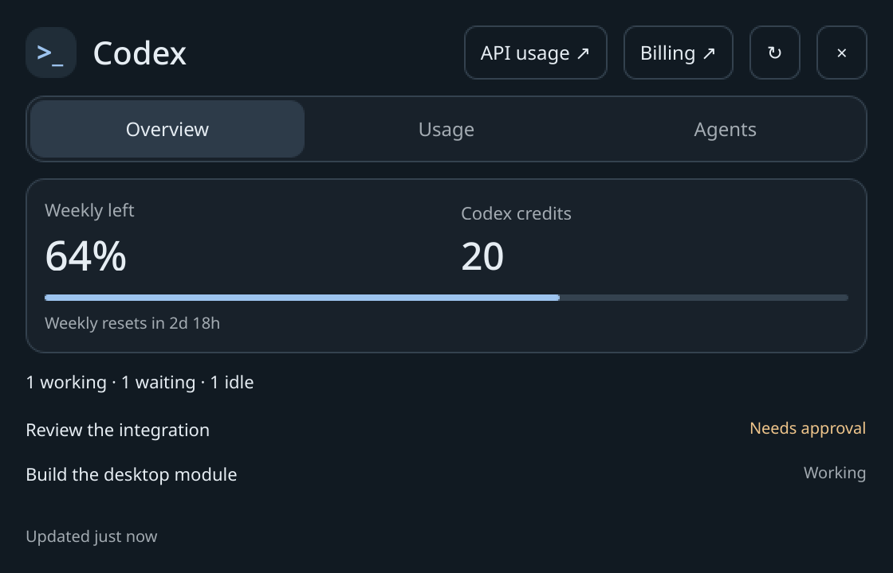
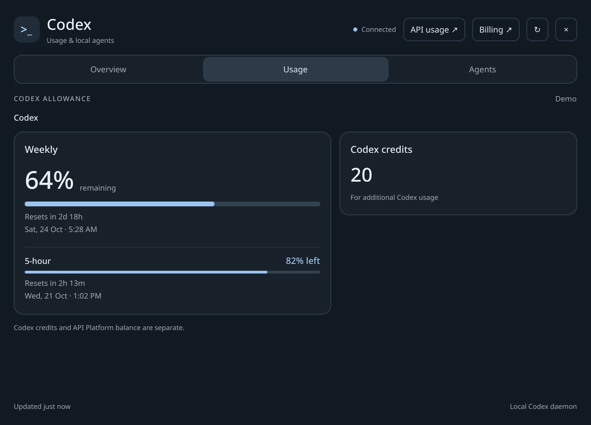
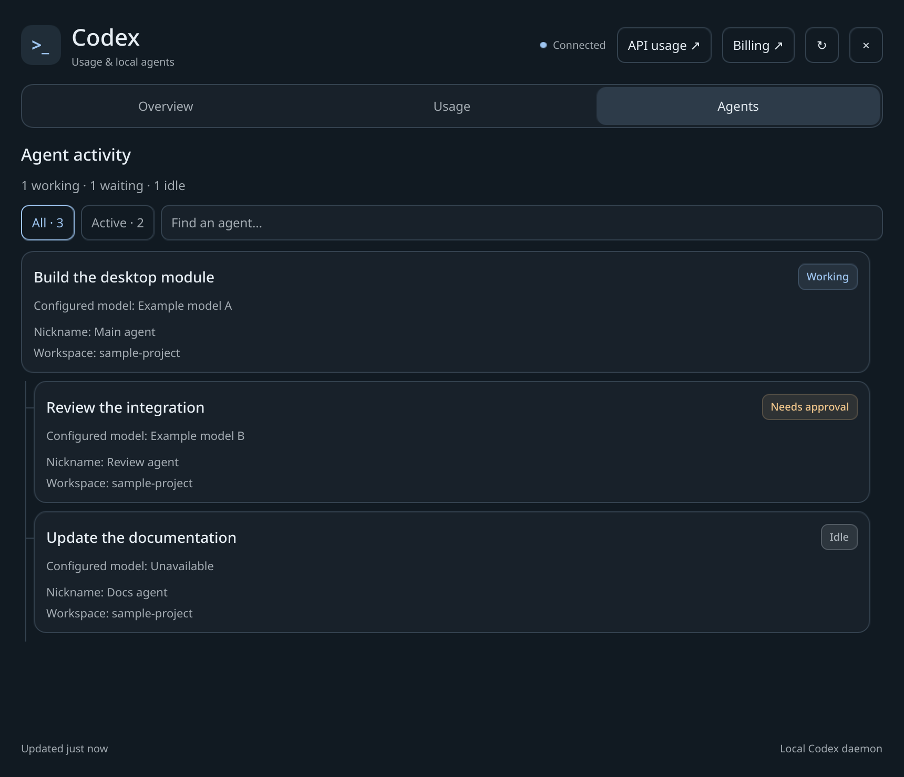

# Codex Quickshell

A small, private Codex status module that lives alongside your Quickshell setup.
Keep the home view compact; open Usage and Agents for the full details.



*Actual interface capture with synthetic demo data; no live account information.*

- Subscription allowance windows, reset times, and exact credit values reported by Codex.
- Loaded sessions and subagents, with their own reported model, nickname, workspace, and state.
- A normal desktop window by default, an optional Hyprland overlay, or your own window host.
- Optional status pill, partial theme overrides, and keyboard navigation.
- Local metadata only, no API key, no model calls, and no payment operations.

**API Platform:** the Usage and Billing buttons open official dashboard pages.
This release does **not** fetch an API balance. API Platform billing and Codex
subscription allowances are separate; neither is estimated from the other.

## Screenshots

These are captures of the actual Quickshell UI using synthetic demo data with
transport disabled. They contain no live account or project data.

### Usage



### Agents



To regenerate the images, run `python3 scripts/capture_screenshots.py`.
See [screenshot provenance](docs/assets/README.md) for details.

## Requirements

Linux, Python 3.11+, Quickshell with Qt 6, and a running Codex daemon that exposes
the local app-server proxy metadata methods. The bridge uses only Python's
standard library. Node is needed only for development checks.

Verified locally with Quickshell 0.3.2, Qt 6.12, and Codex CLI 0.163.0. The Codex
daemon protocol is experimental and may change. Unsupported or disconnected
sources show unavailable/stale states. See [compatibility](docs/compatibility.md)
for the tested scope and limitations.

## Try it alongside your shell

```sh
git clone https://github.com/9MidhunPM/codex-quickshell.git
cd codex-quickshell
python3 scripts/install.py --standalone
```

The installer is a **dry run by default**. To copy the module, create a separate
configuration, and opt into the user service:

```sh
python3 scripts/install.py --install --standalone --activate
qs -p "${XDG_CONFIG_HOME:-$HOME/.config}/quickshell/codex-status"
```

Then open its window from another terminal or a compositor key binding:

```sh
qs ipc -p "${XDG_CONFIG_HOME:-$HOME/.config}/quickshell/codex-status" call codex-status open
```

Your existing shell files are never read or patched. Foreign module directories
and service units are refused. Installation creates only owned files; activation
is explicit. Keep the checkout in place while using its installed backend
service. See [installation and removal](docs/installer.md) before upgrading.

For module-only use: `python3 scripts/install.py --install --no-service`.
For a manual backend: `python3 -m codex_status`. The optional Python wheel
installs this bridge and its CLI only; use the source installer for QML assets.

## Add a pill to your own bar

Import the installed module relative to your shell root:

```qml
import "modules/CodexStatusModule" as Codex

// In your root: create one controller for this Quickshell instance.
Codex.CodexStatus {
    id: codex
    theme: ({accent: "#9dc4ef", fontFamily: "sans-serif"})
}

// In your existing bar row:
Codex.CodexPill {
    controller: codex
    availableWidth: 150 // Space allocated by your own layout.
}
```

The snippets belong in your existing root and visual layout respectively.
Nothing assumes a particular bar, wallpaper, monitor, terminal, or theme object.
See [integration](docs/integration.md) for custom hosts, multi-monitor behavior,
IPC names, socket overrides, and runnable examples.

## Security and truthful status

The bridge connects to the **existing** Codex daemon. Its RPC allowlist reads
account limits and loaded thread metadata; it does not request conversation
contents or saved credentials. The status socket is private to the desktop user.
Metadata can still reveal project names and model choices to that user's apps.
See [the security boundary](SECURITY.md).

Agent models come from each thread's own metadata. Missing values remain unknown.
Nicknames are daemon-assigned labels, not identities inferred by this module.
Only loaded sessions are visible; this is not a global task or process monitor.
Stale or incomplete lists never present a complete active count.

External apps open only after an explicit action. Set `--disable-actions` for
monitor-only operation, or choose a terminal with `--terminal 'foot -e'` during
installation. See [runtime options](docs/runtime.md).

## Development

```sh
make check
make preview
```

The preview uses explicit synthetic fixtures and disables transport. Do not
publish screenshots of your live account. See [contributing](CONTRIBUTING.md)
for tests, Qt tool discovery, and publication privacy checks.

MIT licensed. This is an independent community integration, not an official
OpenAI product.
